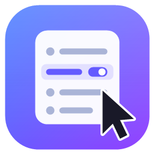

<p align="center">
  
</p>

<h1 align="center">Dredd Menu</h1>
<p align="center"><b>by PiloTDredd</b></p>
<p align="center">Настрой правый клик Windows под себя · Make Windows right-click yours</p>

---

## 🇷🇺 Русский

**Dredd Menu** — программа для настройки контекстного меню Windows 10/11. Видит всё, что программы добавили в правый клик, и даёт включать и выключать пункты одним тумблером.

### Возможности
- **Все разделы меню:** рабочий стол, файлы, папки, диски, отдельные типы файлов (`.png`, `.zip`, `.mp4`…).
- **Новое меню Windows 11:** пункты от приложений из Microsoft Store + переключатель на классическое меню.
- **Свои пункты:** «Открыть в VS Code», «Терминал здесь» или любая программа — по шаблону или вручную.
- **Наборы в один клик:** «Чистое меню», «Для разработчика», «Включить всё», «Выключить битые пункты».
- **Предпросмотр:** видно, как будет выглядеть меню, ещё до применения.
- **Бэкапы:** перед каждым изменением сохраняется, как было. Откат — одной кнопкой.
- **Экспорт/импорт** настроек — перенос на другой ПК.
- **Проверка системы:** права, доступ к реестру, целостность бэкапов, поиск битых пунктов от удалённых программ.
- **Безопасно:** ничего не удаляется. Команды выключаются через `LegacyDisable`, расширения — через список `Shell Extensions\Blocked`. Всё обратимо.
- Русский и английский языки, светлая и тёмная тема.

### Скачать
В разделе **Releases**:
- `DreddMenu-x.x.x-win-x64.exe` — работает сразу, ничего ставить не нужно (~65 МБ).
- `DreddMenu-x.x.x-win-x64-lite.exe` — лёгкая версия (~6 МБ), нужен [.NET 8 Desktop Runtime](https://dotnet.microsoft.com/download/dotnet/8.0).

При запуске Windows спросит права администратора — они нужны, чтобы менять системные пункты меню. Без них программа работает в режиме просмотра.

---

## 🇬🇧 English

**Dredd Menu** is a context menu tuner for Windows 10/11. It shows everything apps have added to your right-click menu and lets you turn items on and off with a single switch.

### Features
- **Every menu location:** desktop, files, folders, drives and specific file types (`.png`, `.zip`, `.mp4`…).
- **Windows 11 menu:** items added by Microsoft Store apps + a switch for the classic menu.
- **Your own items:** "Open in VS Code", "Terminal here" or any app — from a template or by hand.
- **One-click presets:** Clean menu, Developer, Turn everything on, Turn off broken items.
- **Live preview** of the menu before you apply anything.
- **Backups:** the previous state is saved before every change. Roll back with one click.
- **Export/import** your setup to move it to another PC.
- **System check:** permissions, registry access, backup integrity and broken items left by uninstalled apps.
- **Safe:** nothing is deleted. Commands are disabled via `LegacyDisable`, extensions via `Shell Extensions\Blocked`. Everything is reversible.
- Russian and English UI, light and dark themes.

### Download
From **Releases**:
- `DreddMenu-x.x.x-win-x64.exe` — runs as is, nothing to install (~65 MB).
- `DreddMenu-x.x.x-win-x64-lite.exe` — small build (~6 MB), requires [.NET 8 Desktop Runtime](https://dotnet.microsoft.com/download/dotnet/8.0).

Windows will ask for administrator rights on launch — they are needed to change system-wide menu items. Without them the app runs in view-only mode.

---

## 🛠 Build / Сборка

```bash
dotnet build -c Release
```

Release (single file, self-contained):

```bash
dotnet publish -c Release -r win-x64 --self-contained true -p:PublishSingleFile=true -p:IncludeNativeLibrariesForSelfExtract=true -p:EnableCompressionInSingleFile=true -p:DebugType=none -o release
```

Stack: C# · .NET 8 · WPF · [WPF-UI](https://github.com/lepoco/wpfui)

## ❤ Support / Поддержать

Программа бесплатная. Если она тебе помогла — [поддержать автора](https://pay.cloudtips.ru/p/129557e1).
The app is free. If it helped you — [support the author](https://pay.cloudtips.ru/p/129557e1).

## License

[MIT](LICENSE) © 2026 PiloTDredd
